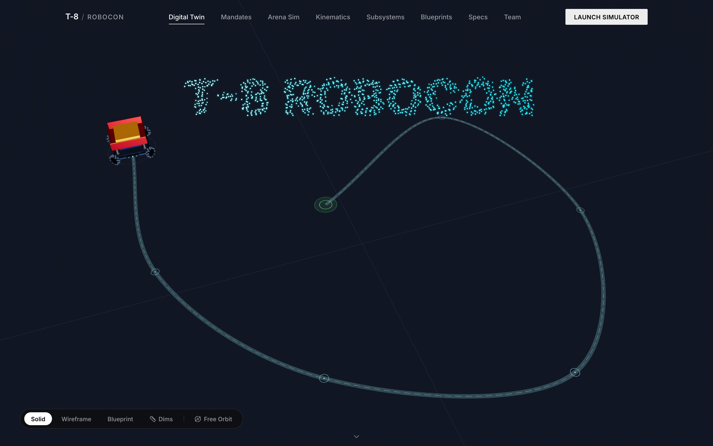
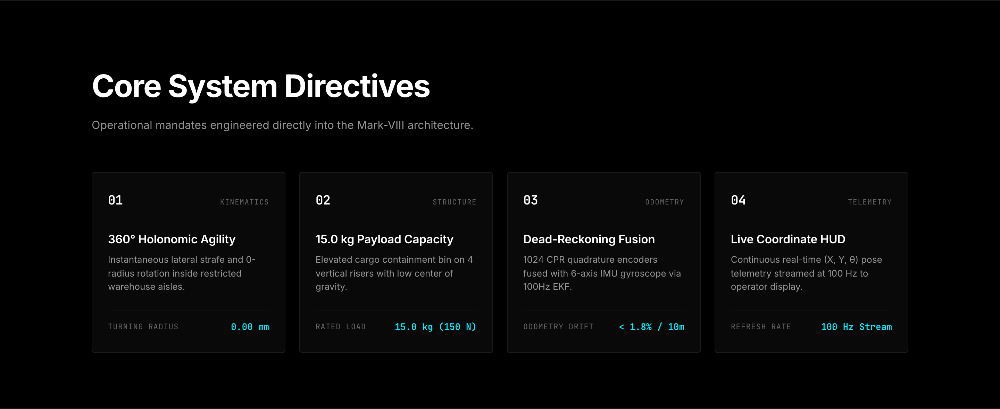
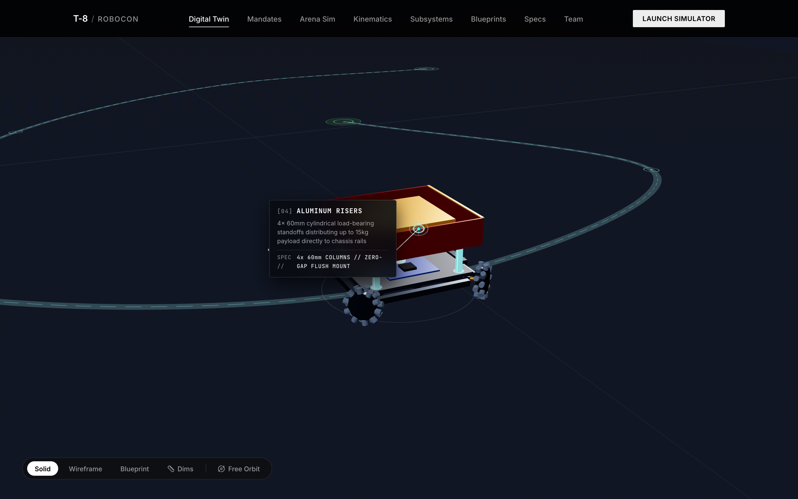
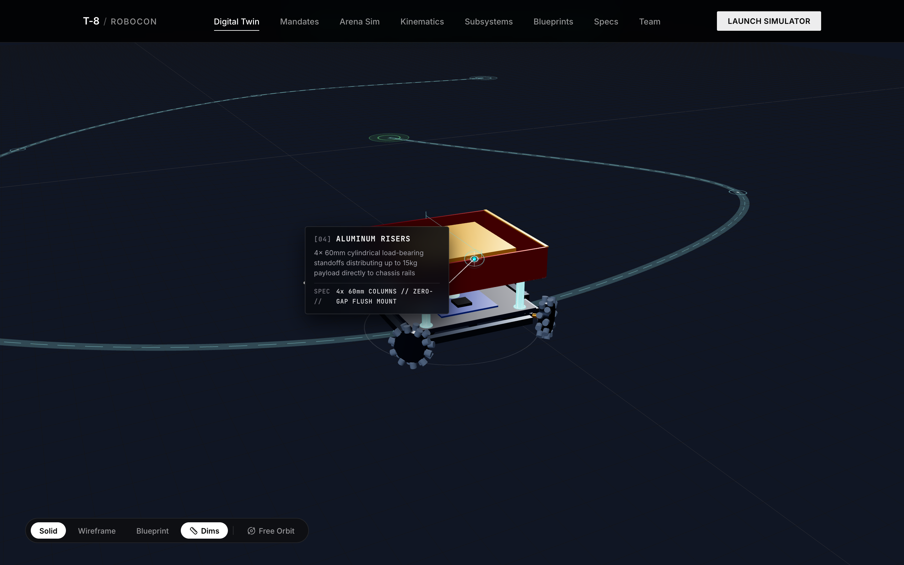
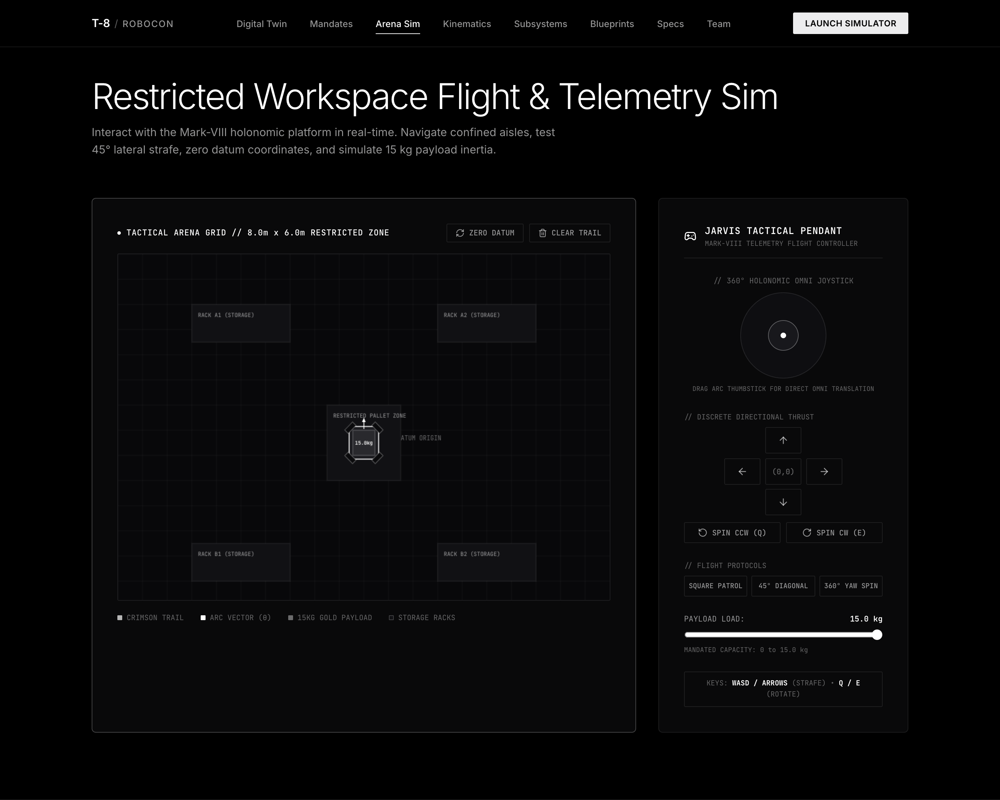
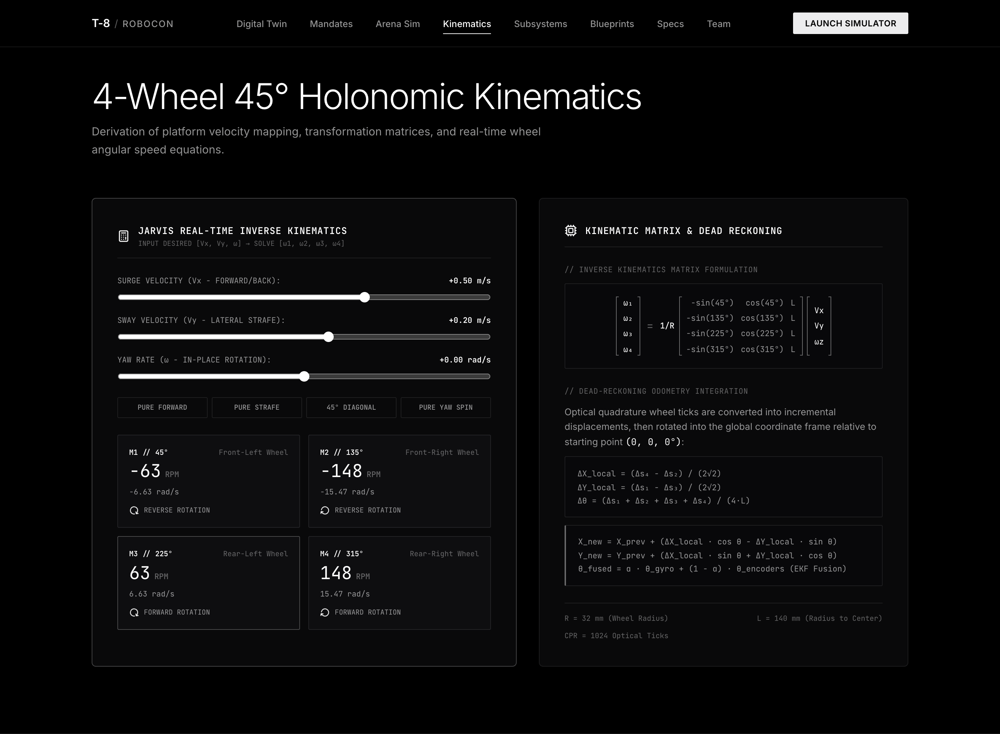
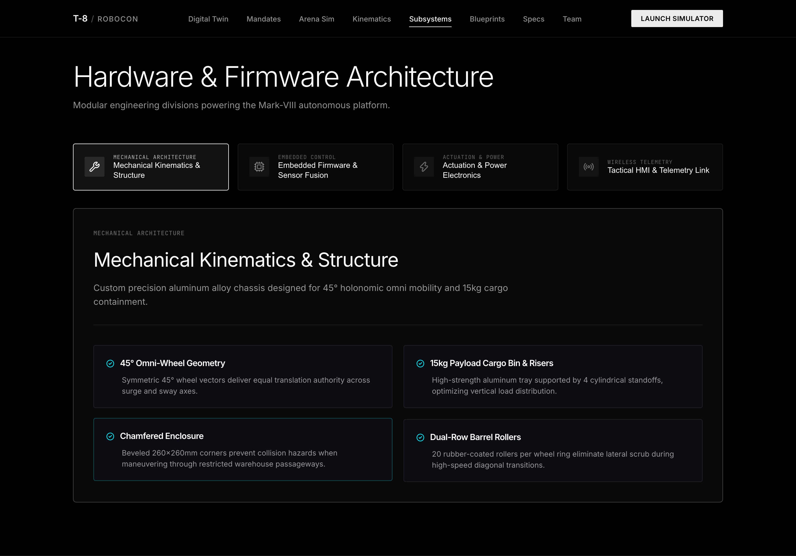
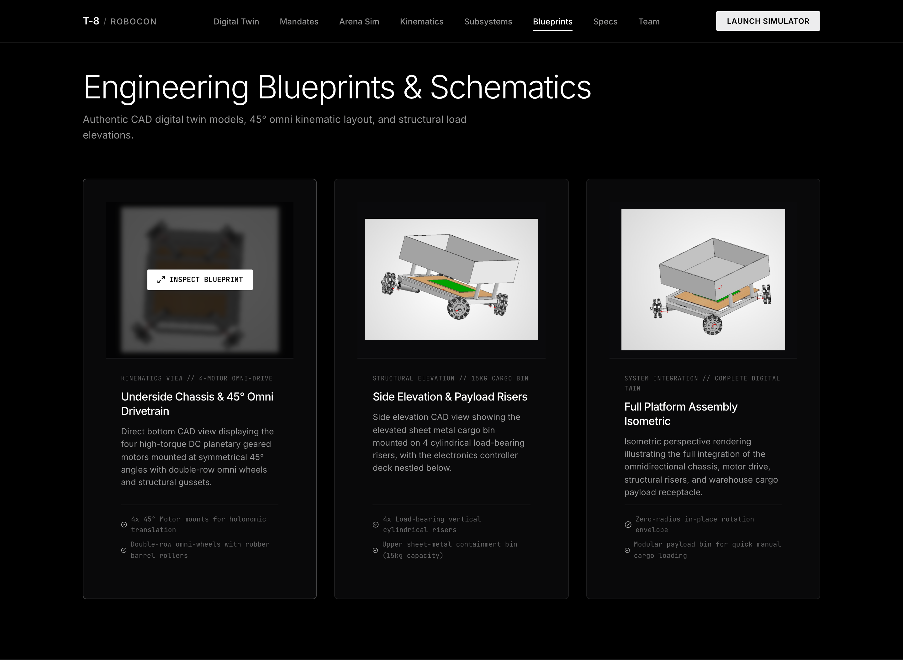
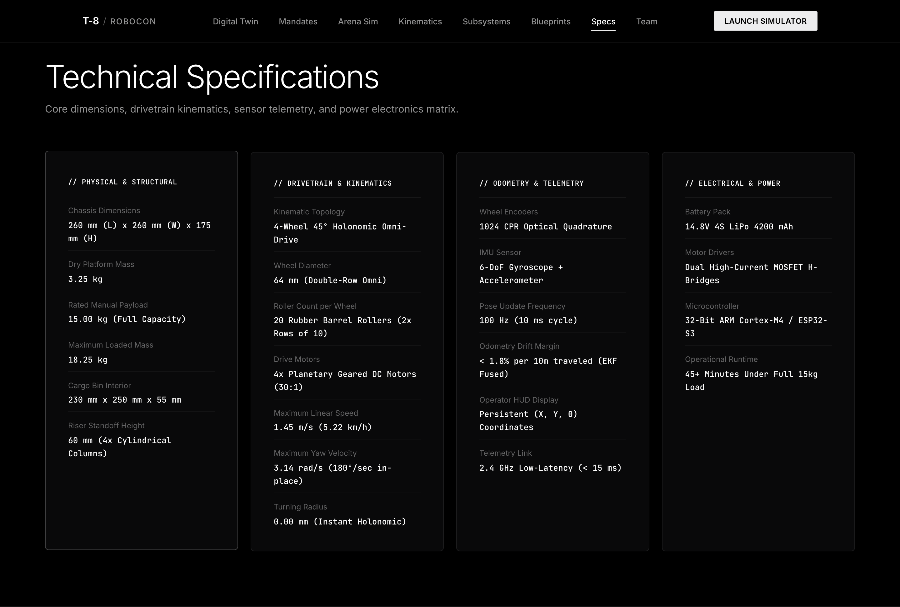
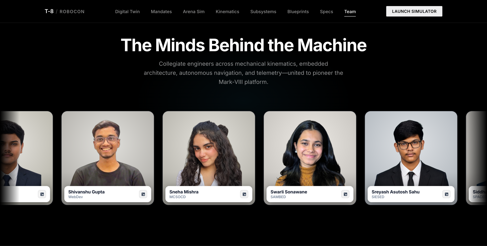

# T-8 ROBOCON // MARK-VIII OMNI-CARRIER

<div align="center">

[](https://t-8-robocon.vercel.app)
[](https://vitejs.dev/)
[](https://react.dev/)
[](https://threejs.org/)
[](https://developer.mozilla.org/en-US/docs/Web/API/Web_Audio_API)
[](LICENSE)

**Official interactive web portal, 3D digital twin, and holonomic flight simulator for Robocon Team 8 (T-8 Robocon) — engineered specifically for ABU Robocon Problem Statement 8.**

[🌐 Explore Live Portal](https://t-8-robocon.vercel.app) • [🕹️ Launch Arena Simulator](https://t-8-robocon.vercel.app/#timeline) • [📐 CAD Digital Twin](https://t-8-robocon.vercel.app/#cad) • [👥 Team Roster](https://t-8-robocon.vercel.app/#team)

</div>

---

## 📸 Portal Overview

<div align="center">
  
  <p><em>Interactive Three.js Digital Twin with procedural particle cloud, Catmull-Rom trajectory, and persistent telemetry HUD dock.</em></p>
</div>

---

## 📑 Table of Contents

- [🏆 Problem Statement 8 Brief](#-problem-statement-8-brief)
- [✨ Key System Directives](#-key-system-directives)
- [🖼️ Visual Showcase & Screenshots](#️-visual-showcase--screenshots)
  - [1. 3D Digital Twin & Trajectory Choreography](#1-3d-digital-twin--trajectory-choreography)
  - [2. CAD Blueprints & Dimension Inspection](#2-cad-blueprints--dimension-inspection)
  - [3. Restricted Workspace Arena Simulator](#3-restricted-workspace-arena-simulator)
  - [4. 4-Wheel 45° Holonomic Inverse Kinematics](#4-4-wheel-45-holonomic-inverse-kinematics)
  - [5. Hardware & Firmware Subsystems](#5-hardware--firmware-subsystems)
  - [6. Engineering Blueprint Archives](#6-engineering-blueprint-archives)
  - [7. Technical Specifications Matrix](#7-technical-specifications-matrix)
  - [8. Team & Engineering Divisions](#8-team--engineering-divisions)
- [🧮 Mathematical Foundations & Kinematics](#-mathematical-foundations--kinematics)
- [🔊 Real-Time Audio Synthesis Engine](#-real-time-audio-synthesis-engine)
- [🛠️ Tech Stack](#️-tech-stack)
- [📂 Project Structure](#-project-structure)
- [🚀 Quick Start Guide](#-quick-start-guide)
- [🚢 Deployment](#-deployment)
- [👥 Engineering Team](#-engineering-team)
- [📜 License](#-license)

---

## 🏆 Problem Statement 8 Brief

> *"A warehouse operator controls a mobile platform which can carry up to 15kgs manually inside a restricted workspace where movement in several directions is useful. The platform should be able to translate and reposition itself while keeping track of how far it has travelled and where it believes it is relative to its starting point. The challenge is to combine intuitive manual control with dependable motion and position estimation. The operator demands the x, y coordinates as well as the angle of the mobile platform to be displayed at all times."*

### Mission Mandates
1. **Holonomic Agility**: Instantaneous 360° omnidirectional translation and 0-radius turning without chassis reorientation.
2. **Payload Capacity**: Stably support and transport rated 15.0 kg (150 N) mass in an elevated cargo bin with minimal center-of-gravity deflection.
3. **Continuous Odometry**: Dead-reckoning sensor fusion maintaining $< 1.8\%$ drift over 10 meters using quadrature encoders and 6-axis IMU.
4. **Live Telemetry Display**: Real-time $(X, Y, \theta)$ HUD coordinates streamed at 100 Hz to operator pendant.

---

## ✨ Key System Directives

<div align="center">
  
</div>

| # | Directive | Specification | Operational Mandate |
|---|---|---|---|
| **01** | **Kinematics** | `360° Holonomic Agility` | Instantaneous lateral strafe and 0.00 mm turning radius inside restricted aisles. |
| **02** | **Structure** | `15.0 kg Payload Capacity` | Elevated cargo bin on 4 cylindrical standoffs with optimized low center-of-gravity. |
| **03** | **Odometry** | `Dead-Reckoning Fusion` | 1024 CPR quadrature encoders fused with 6-axis IMU gyroscope via 100 Hz EKF. |
| **04** | **Telemetry** | `Live Coordinate HUD` | Continuous real-time $(X, Y, \theta)$ pose telemetry streamed at 100 Hz to operator HUD. |

---

## 🖼️ Visual Showcase & Screenshots

### 1. 3D Digital Twin & Trajectory Choreography
High-fidelity Three.js procedural model matching exact CAD blueprints: 4-wheel 45° omni-drive chassis, aluminum perimeter rails, wooden mounting plate, electronics controller deck, 4 vertical cylindrical standoffs, and the 15 kg payload cargo container bin. As the user scrolls, the robot navigates a smooth Catmull-Rom trajectory through a simulated warehouse path with real-time dynamic callouts.

<div align="center">
  
  <p><em>Active simulation path traversal displaying interactive structural component callout for the load-bearing risers.</em></p>
</div>

### 2. CAD Blueprints & Dimension Inspection
Inspect the robot in full solid shading, wireframe, or blueprint CAD render modes. Hovering over components reveals precise millimeters engineering dimensions and mechanical specifications.

<div align="center">
  
  <p><em>Interactive CAD model inspection with dimension callouts and display modes.</em></p>
</div>

### 3. Restricted Workspace Arena Simulator
Full 2D interactive tactical simulator replicating an $8.0\text{ m} \times 6.0\text{ m}$ warehouse arena with storage racks, restricted pallet zones, live breadcrumb trajectory mapping, analog virtual joystick, discrete directional thrusters, automated flight protocols (square patrol, diagonal transit, yaw spin), and an adjustable 0–15 kg payload inertia slider.

<div align="center">
  
  <p><em>Tactical flight pendant and 2D canvas holonomic arena simulation.</em></p>
</div>

### 4. 4-Wheel 45° Holonomic Inverse Kinematics
Interactive kinematics calculation engine demonstrating real-time matrix transformation from desired platform velocities $[V_x, V_y, \omega]$ to individual wheel angular velocities $[\omega_1, \omega_2, \omega_3, \omega_4]$ with live RPM gauges and dead-reckoning sensor fusion formulas.

<div align="center">
  
  <p><em>Real-time velocity sliders, inverse kinematics solver, and mathematical derivation matrix.</em></p>
</div>

### 5. Hardware & Firmware Subsystems
Detailed breakdown of the 4 specialized engineering divisions powering the Mark-VIII architecture: Mechanical Kinematics (SAMBED), Embedded Firmware (SPACED), Actuation & Power (SIESED), and Wireless Telemetry (MCSOCD).

<div align="center">
  
  <p><em>Subsystem engineering divisions and technical architecture tabs.</em></p>
</div>

### 6. Engineering Blueprint Archives
Authentic CAD schematics, orthographic projections, and elevation views illustrating the 4-motor chassis layout, double-row omni-wheels, and cargo receptacle mounting.

<div align="center">
  
  <p><em>Blueprint gallery featuring underside drivetrain, side elevation, and isometric assembly renders.</em></p>
</div>

### 7. Technical Specifications Matrix
Comprehensive engineering specifications covering physical dimensions, drivetrain kinematics, sensor telemetry, and power electronics.

<div align="center">
  
  <p><em>Engineering metrics matrix and technical FAQ.</em></p>
</div>

### 8. Team & Engineering Divisions
Meet the engineering team and division leads behind the design, simulation, and physical fabrication of the Mark-VIII platform.

<div align="center">
  
  <p><em>Team division leads and collegiate engineering contributors.</em></p>
</div>

---

## 🧮 Mathematical Foundations & Kinematics

The Mark-VIII chassis utilizes four double-row omni-directional wheels configured at symmetric $45^\circ$, $135^\circ$, $225^\circ$, and $315^\circ$ angles relative to the chassis center.

### Inverse Kinematics Matrix
Given platform surge velocity $V_x$, sway velocity $V_y$, and angular yaw rate $\omega$, the wheel speeds $\omega_i$ are governed by:

$$\begin{bmatrix} \omega_1 \\ \omega_2 \\ \omega_3 \\ \omega_4 \end{bmatrix} = \frac{1}{R} \begin{bmatrix} -\sin(45^\circ) & \cos(45^\circ) & L \\ -\sin(135^\circ) & \cos(135^\circ) & L \\ -\sin(225^\circ) & \cos(225^\circ) & L \\ -\sin(315^\circ) & \cos(315^\circ) & L \end{bmatrix} \begin{bmatrix} V_x \\ V_y \\ \omega \end{bmatrix}$$

Where:
- $R = 32\text{ mm}$ (Omni-wheel radius)
- $L = 140\text{ mm}$ (Radial distance from chassis center to wheel contact point)

### Dead-Reckoning Odometry & EKF Fusion
Optical quadrature ticks yield incremental wheel displacements $[\Delta s_1, \Delta s_2, \Delta s_3, \Delta s_4]$. Local chassis displacements are computed as:

$$\Delta X_{\text{local}} = \frac{\Delta s_4 - \Delta s_2}{2\sqrt{2}}, \quad \Delta Y_{\text{local}} = \frac{\Delta s_1 - \Delta s_3}{2\sqrt{2}}$$

$$\Delta \theta = \frac{\Delta s_1 + \Delta s_2 + \Delta s_3 + \Delta s_4}{4L}$$

The global position is accumulated and fused with the 6-axis IMU gyroscope through a 100 Hz Extended Kalman Filter:

$$X_{k} = X_{k-1} + \Delta X_{\text{local}} \cos\theta - \Delta Y_{\text{local}} \sin\theta$$

$$Y_{k} = Y_{k-1} + \Delta X_{\text{local}} \sin\theta + \Delta Y_{\text{local}} \cos\theta$$

$$\theta_{\text{fused}} = \alpha \cdot \theta_{\text{gyro}} + (1 - \alpha) \cdot \theta_{\text{encoders}}$$

---

## 🔊 Real-Time Audio Synthesis Engine

The platform features a dual-layer procedural audio engine using the **Web Audio API**:
- **Dual Layer Acoustic Blend**: High-fidelity mechanical WAV rolling sample blended dynamically with a sawtooth planetary gear oscillator and bandpass pink/brown friction filter.
- **Physical Gating**: The audio engine remains completely silent when the vehicle is stationary at the starting depot or docked at the destination bay. Audio plays exclusively when the robot is actively moving along the Catmull-Rom path or being steered in the arena simulator.
- **Velocity-Modulated Pitch & Volume**: Modulates smoothly between deep rumble ($680\text{ Hz}$ at low crawl) up to bright gear whining ($3900\text{ Hz}$ at sprint speeds) with realistic momentum coast-down inertia.

---

## 🛠️ Tech Stack

- **Core Framework**: [React 18](https://react.dev/) + [Vite 5](https://vitejs.dev/)
- **3D Graphics & Shaders**: [Three.js](https://threejs.org/) (Custom procedural materials, OrbitControls, Catmull-Rom splines, particle text)
- **Audio Engine**: Web Audio API (BiquadFilterNode, OscillatorNode, GainNode)
- **2D Tactical Simulator**: HTML5 Canvas API (60 FPS physics loop, collision detection, breadcrumbs trail)
- **Icons**: [Lucide React](https://lucide.dev/)
- **Styling**: Vanilla CSS Design System with cybernetic dark aesthetic, glassmorphism, and responsive viewports

---

## 📂 Project Structure

```bash
t-8-robocon/
├── public/
│   ├── assets/
│   │   ├── audio/              # High-fidelity rolling WAV sample
│   │   ├── cad/                # Rendered orthographic CAD blueprints
│   │   ├── screenshots/        # High-res portal snapshots (01 to 10)
│   │   └── team/               # Team member profile photographs
├── src/
│   ├── components/
│   │   ├── ArenaSimulator.jsx  # 2D Canvas tactical flight & teleop simulator
│   │   ├── CadGallery.jsx      # CAD blueprint archives & schematics
│   │   ├── CurvedLoop.jsx      # SVG dynamic curved typography banner
│   │   ├── Footer.jsx          # Engineering credits & sitemap
│   │   ├── HeroSection.jsx     # Hero corridor & scroll orchestration
│   │   ├── KinematicsEngine.jsx# Holonomic matrix math & RPM solver
│   │   ├── MandatesSection.jsx # Problem Statement 8 Core Directives
│   │   ├── Navbar.jsx          # Glassmorphic telemetry header & nav
│   │   ├── ParticleText.jsx    # Three.js particle dispersion typography
│   │   ├── Robo3DCanvas.jsx    # Procedural 3D Three.js CAD Digital Twin
│   │   ├── ScrollVelocity.jsx  # Kinetic scrolling velocity banners
│   │   ├── SpecificationsFaq.jsx# Specs matrix & technical FAQ
│   │   ├── TeamSection.jsx     # Team engineering roster & division tags
│   │   └── TelemetryHUD.jsx    # Floating real-time (X, Y, θ) operator HUD
│   ├── utils/
│   │   └── wheelAudio.js       # Web Audio API physical acoustic engine
│   ├── App.jsx                 # Root component & telemetry distributor
│   ├── index.css               # Global CSS design tokens & typography
│   └── main.jsx                # Application bootstrap
├── scratch/
│   └── take_screenshots.js    # High-resolution screenshot capture script
├── package.json
├── vite.config.js
└── README.md
```

---

## 🚀 Quick Start Guide

### Prerequisites
- [Node.js](https://nodejs.org/) (v18.0.0 or later)
- [npm](https://www.npmjs.com/) (v9.0.0 or later)

### Installation

```bash
# 1. Clone the repository
git clone git@github.com:ArvindShivanshu/t-8-robocon.git
cd t-8-robocon

# 2. Install dependencies
npm install

# 3. Launch local development server
npm run dev
```

Open [http://localhost:3000](http://localhost:3000) in your browser to view the live portal.

---

## 🚢 Deployment

The application is deployed on **Vercel** with automatic continuous deployment linked to the `main` branch:

```bash
# Build optimized production bundle
npm run build

# Preview production build locally
npm run preview
```

Live URL: **[https://t-8-robocon.vercel.app](https://t-8-robocon.vercel.app)**

---

## 👥 Engineering Team

| Division | Domain | Core Responsibilities |
|---|---|---|
| **SAMBED** | Mechanical Kinematics | 45° Omni-wheel mount geometry, aluminum chassis rails, 15 kg payload bin, cylindrical risers. |
| **SPACED** | Embedded Firmware | 100 Hz Extended Kalman Filter, optical quadrature decoding, 6-axis IMU sensor fusion. |
| **SIESED** | Actuation & Power | 14.8V 4S LiPo power distribution, planetary geared DC motors, dual MOSFET H-bridge drivers. |
| **MCSOCD** | Wireless Telemetry & HMI | 2.4 GHz low-latency telemetry protocol, operator HUD display, manual pendant interface. |

---

## 📜 License

This project is licensed under the **MIT License** — see the [LICENSE](LICENSE) file for details.

Developed for **Robocon Team 8 (T-8 Robocon)** // Problem Statement 8.
